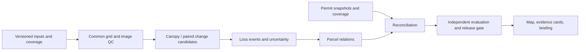

# Research and technical direction

Decision record D01, 2026-10-14 (America/Los_Angeles). Status: initial direction, with explicit feasibility gates. [Evidence and archive reassessment](research/2026-10-14-planning/findings.md). [Execution/state entry point](../checklist.md).

## Question and useful output

Can repeatable analysis of public aerial imagery identify **gross tree-canopy loss events** at a useful local scale, associate them with intersecting parcels and relevant administrative records, and produce an inspection queue whose reliability and gaps are measurable?

The primary users are agency analysts/arborists reviewing candidates, researchers reproducing findings, and residents understanding local canopy change. The first product should help a reviewer answer: what visibly changed, between which observations, how reliable is that interpretation, which parcels overlap it, what records were searched, and what still needs checking? Agency workflow fit remains a hypothesis until feedback is obtained; agents can prepare the evaluation and briefing without contacting anyone.

Deliver a repeatable research pipeline, independently evaluated loss layer, evidence cards and review export, accessible public map/explanation, and an agency briefing. A negative feasibility result is legitimate research but does not complete the intended operational system. Track readiness of each deliverable separately. There is no promised accuracy, completed dataset, or operating service today.

## Scope and consequential decisions

| Choice | Initial direction | Tradeoff / reconsideration trigger |
|---|---|---|
| Region | **City of Atlanta municipal boundary first**, including its Fulton and DeKalb portions; freeze a dated official geometry | One municipal permit regime reduces complexity. Do not conflate city, county, mailing address, or the archive's rectangle. Extend only after separate coverage/validation |
| Staging | A stratified multi-neighborhood pilot before full-city processing | More useful than one convenient leafy neighborhood. Pilot findings cannot be extrapolated citywide |
| Interval | Prefer 2023→2025 if usable/retrievable; bounded fallback check of 2019→2023 | Recent interval improves relevance; older interval reduces immediacy and lengthens date ambiguity. T06 must label the selected interval honestly |
| Phenology | Per-asset acquisition dates, seamlines and pixel inspection; 2021 excluded from primary pilot by default | Late-season metadata is a warning, not measured leaf state; no unsupported universal epoch rule |
| Method | Simple spectral/texture random forest plus one accessible fixed pretrained candidate; optional small learned challenger | Establish a cost/quality baseline before paying annotation/training complexity. U-Net is a candidate, not a commitment |
| Measurement | Gross loss of visible tree-crown cover between two observations | Not stem removal, tree health, precise height/DBH, cause, exact removal date, legal ownership, net change, or an offense |
| Local scale | Test 0.05, 0.10, 0.25 acre event floors on development data; **0.10 acre is the initial reporting hypothesis** | Small clearings are useful but may be below credible positional/phenology limits. Report recall by size and explicitly exclude unvalidated scales |
| Permit meaning | `matched / ambiguous / unmatched`, with independent source-coverage and reason fields | A building application or missing row cannot establish tree authorization or wrongdoing |
| Publication | Develop aggregates and reviewed evidence-card views; recommend aggregates as initial public default | Parcel detail may improve triage but requires explicit release-granularity/record-handling decision before publication. Agency packet may be more detailed only with authorized handling |
| Operations | File-based, versioned batch analysis and a static read-only map | Low recurring cost and simple audit/recovery. Add services only for demonstrated needs, not an assumed platform |

Do not silently shrink the region to successful tiles. Freeze the intended region and publish valid-observation, no-data, unsuitable-image, and record-coverage masks against that denominator. A valid-area subset is acceptable if named and quantified. The first pilot should cover at least three separated areas spanning canopy density, built form, acquisition conditions, and available neighborhood income context; T06 chooses actual footprints from T01/T02, without inspecting protected outcomes.

No real-time monitoring promise, parcel fines, individual-tree counting, canopy gain, speculative dollar benefits, causal enforcement claims, or daily sign collector in the core campaign. New intervals or jurisdictions need new readiness and validation; a future flight is not a scheduled service guarantee.

## Measurement and data contracts

Canopy follows the observable overhead crown concept used by GT, distinguishing trees from grass/shrub/vine cover and nonvegetation. Annotation allows `uncertain/obscured`; exact height >3 m is not claimed from optical appearance. **Our gross-loss estimand is endpoint-visible canopy loss:** cover present at the first observation and absent at the second, without subtracting gains elsewhere. Removal followed by regrowth between images can be invisible; we do not estimate all removals during the interval. Probability sampling cannot recover that unseen history. Leaf loss, shadows, pruning, crown movement, dead standing trees and image differences are explicit alternative explanations. Loss date is an interval between **local** observations, widened/marked unknown where mosaics have unresolved dates.

Inputs carry original provider IDs/URLs, retrieval and acquisition times, license/terms, hashes, bands/bit depth, nodata, CRS/grid/resolution, footprint, lineage and known exclusions. A live URL alone is not a preserved input. Historical parcel geometry is preferred; current-only parcels must expose vintage mismatch, splits/mergers and unavailable history. Do not impute historical owners.

Core interfaces to freeze in T06:

- **Image observation:** immutable asset ID; source date or date range; usable mask; grid; source seamline; QC flags. Overlapping quads require a deterministic source-priority/mosaic rule.
- **Loss event:** stable release-scoped ID; connected geometry before parcel intersection; area in square meters; observation interval; pipeline/config IDs; quality tier and reasons; original and filtered lineage. Physical-area MMU applies to the event, not each parcel fragment. Preserve subthreshold candidates for auditing, not for validated claims.
- **Event–parcel relation:** many-to-many overlap with absolute/fractional area, parcel vintage and jurisdiction; retain unassigned/right-of-way pieces. Event totals are not multiplied by parcel joins. Crown overhang is not stem ownership.
- **Permit record:** source ID and immutable snapshot; jurisdiction/authority; type; status history where available; application/approval/expiry/amendment dates; parcel/address linkage; explicit tree-review evidence; record-family/parent-child links; coverage window. Keep raw observations separate from normalization.
- **Reconciliation:** event/record relation and explanation; three-way result; coverage state (`adequate_for_search`, `partial`, `unavailable`, `out_of_scope`); spatial/time/status uncertainty; review history. `unmatched` means no compatible record in an adequately described search universe, never “unpermitted.” With insufficient coverage use `ambiguous` plus reason. Loss events remain available for scientific analysis regardless of permit status.
- **Run/release:** code revision, environment lock, source/label/split/config/model hashes, stage manifests, checks, estimates versus measured resources, output locations and last confirmed durable copy.

Permit matching searches authorizations that may precede the first image and relevant later records, using verified validity/emergency/amendment rules rather than an arbitrary ±days window. If removal time spans different ordinance regimes, retain that uncertainty. Match parcel/record family before fuzzy address fallback; retain candidates and scores, resolve many-to-many ambiguity, and record manual overrides. Building permits without confirmed tree approval supply development context only. Independent location/date/status validation is required even for a strong ID match. A matched record does not prove that the particular lost crown was authorized.

## Pipeline and repository shape

Default implementation: Python package with a small CLI, locked dependencies and configuration files; Rasterio/GDAL, NumPy, Shapely/GeoPandas as needed, scikit-learn baseline, optional PyTorch only after a justified model task. Prefer a portable environment proven on a real crop over immediately building a container platform. Notebook exploration must export reusable code/configs. No Earth Engine, Colab or proprietary license dependency is assumed.

Use COGs for raster artifacts, GeoParquet for canonical geometry/tables, GeoPackage for small human-review interchange, JSON manifests, and CSV for nonspatial summaries. Start with filesystem operations and optionally DuckDB for joins; no database server, task scheduler or custom autonomous-agent framework is required. A minimal resumable stage runner is justified only by the actual pipeline. Module boundaries: `src/canopy/{acquire,prepare,detect,attribute,permits,evaluate,release}`. Create modules when their item begins, not empty scaffolding now.

Candidate analysis grid: NAD83 / UTM zone 16N (EPSG:26916), meters, matching sampled NAIP metadata. T06 freezes grid origin/resolution, transformations and area checks. Evaluate at a common effective resolution no finer than credible inputs, initially 0.6 m if both support it. Continuous-band resampling and categorical/mask resampling need distinct methods. Transform once where possible; never calculate areas in web-map coordinates. Export display geometry separately.

Measure registration before correction using stable ground features independent of canopy change. Compare no correction, global and local correction where warranted; assess residuals on withheld check points and seamline discontinuities. Record spatial error and perturb events within that error to test area/parcel/rank sensitivity. No universal subpixel pass is claimed before pilot evidence. Exclude or downgrade locally unresolvable areas, preserving denominators. Morphology/compactness filters require ablation: thin utility corridors and fragmented redevelopment can be real loss.

Prefer a static MapLibre map with small GeoJSON during development and PMTiles only when size warrants; local builds precede hosting selection. The data bundle is independent of the frontend. Show before/after dates, valid coverage, source freshness, uncertainty, permit-search meaning, methods and downloadable summaries. Provide accessible text/table alternatives and a correction path. Keep names/contact details out of public data; record licenses for imagery previews, basemaps, fonts and derived layers. No paid hosting or public deployment without the working agreement's authorization.

## Validation is part of the product

T07 preregisters the reference response design, estimands, selection rules and analysis **before** protected evaluation is inspected. Development examples may change the method; the protected sample may not. Keep both dates, overlapping chips, event sites and related parcels in the same geographic split; add buffers based on context and spatial dependence. NPUs are reporting strata, not automatic leakage protection. Exclude protected areas from local pseudo-label training, fine-tuning and threshold selection. Disclose upstream pretrained training overlap; “independent labels” is not the same as “globally unseen geography.”

Keep two geographic estimands explicit. **Generalization evaluation** uses the reserved buffered holdout domain and reports results for that domain; purposively chosen held-out areas cannot support design-based citywide totals. **Operational map evaluation**, if regional estimates are sought, uses a separate probability survey of the entire eligible frozen-map domain, including development geography in its actual population share. Draw it only after method freeze, independently interpret it, mark overlap with prior training/annotation footprints, and never advertise its metrics as wholly unseen-geography performance. If the full-domain survey is not feasible, publish detected mapped area and supported-domain evaluation only, without an adjusted citywide loss estimate.

Within those frames, sample landscape units spanning predicted loss, uncertain and predicted nonloss for missed-loss/area estimation, plus an event/parcel review sample for the operational queue. Retain inclusion probabilities and cluster IDs, preregister edge-crossing event inclusion and fragmentation rules, reference nonresponse handling, and avoid event size-biased estimates. Targeted failure examples and field convenience sites stay separate. Sample-size planning uses pilot prevalence, clustering and a realistic human-time budget, not the archive's arbitrary tile/visit counts. Humans independently interpret an overlap subset and adjudicate disagreement, preferably blind to model/permit results. Agent-assisted annotation is development assistance, not independent reference truth. T13 accepts the final reviewed T07 protocol revision and actual reference-capacity commitment before protected selection or evaluation.

Evaluate separately:

| Layer | Required evidence |
|---|---|
| Canopy per epoch | Class confusion, tree precision/recall/IoU, shadow/unknown handling, inter-annotator agreement; do not substitute overall accuracy for tree/change accuracy |
| Gross loss | Event precision/recall using frozen matching/tolerance rules; area error; missed changes in nonloss sample; small/large event and fragmentation results; design-consistent intervals |
| Parcel attribution | Correct intersecting set/area, boundary/vintage sensitivity, unassigned fraction, no double counting; no ownership claim |
| Permits | Adjudicated compatible-record precision/recall where records permit it, three-way confusion, abstention and coverage rates, hard edge cases; no unlawful-removal classifier |
| Practical use | Precision/yield at a fixed review budget, ranking stability, evidence-card interpretability, time per case; compare with simple area-only ranking |

Proposed promotion target for a **high-confidence inspection queue**: event precision with a one-sided 95% lower confidence bound at least 0.90; event recall point estimate at least 0.70 at the chosen MMU, reporting its full interval and whether it is sufficiently precise for use. T07 must set a justified recall-interval precision requirement and sample allocation before evaluation; these are proposed engineering criteria, not inherited performance claims. Also report coverage/yield: an empty queue cannot pass by abstaining everywhere. Pilot evidence must justify a minimum useful queue/coverage requirement in T07. If sample resources cannot support those claims, label the result exploratory and leave operational readiness incomplete. Surface substantive target changes with rationale before protected evaluation; never lower thresholds after seeing a disappointing test.

Report by canopy density, acquisition conditions, neighborhood and area-level income bands (source/vintage/MOE included), with sample denominators and intervals. Sparse strata are “insufficient evidence”; do not infer individual income, causality, or fairness from a map correlation. Ranking must not use income or owner characteristics; test subgroup coverage and precision. A single citywide score cannot hide a failing neighborhood stratum.

Distinguish mapped detected area from design-adjusted estimated gross loss. Only estimate region totals when probability sampling supports them, with no-data coverage explicit. Propagate label, sample, registration, temporal and parcel uncertainties or give bounded sensitivities; a network confidence score is not a calibrated event probability. Permit uncertainty remains separate from image confidence.

Freeze the configuration before final evaluation, evaluate once, and obtain independent reproduction of central quantitative findings. After test-guided revisions, label the old test as development and design a new protected evaluation. GT maps/review sites can be a secondary comparison, subject to access/rights; they are neither independent change truth by default nor a substitute for local reference observations. Current field visits can corroborate present land use, not prove a historical removal date or authorization.

## Evidence gates and recoverability

1. **G1: feasible study contract (T06).** Readable paired sample assets, boundary/parcel and source coverage records, credible reference plan and recoverable artifact path. Missing permit access permits loss work to continue, but leaves reconciliation coverage unproven. If no pair is usable, prepare a concrete access action and stop only dependent work.
2. **G2: method selection (T13).** Development comparison, documented costs/errors/registration, reference feasibility, and independent review. A simple method can win. A no-go preserves the negative result and requests a bounded redesign.
3. **G3: validated research (T18–T20).** Protected evaluation, independent reproduction, uncertainty and disclosure of unsupported strata. Failure limits claims rather than automatically creating a new model experiment.
4. **G4: public and agency delivery (T21–T25).** Reviewable release, approved handling/granularity and deployment, briefing delivery evidence, documented rerun and maintenance ownership. A deployed prototype is not a validated study; a prepared deck is not a delivered briefing.

Before substantive jobs, use the run-record requirements in `AGENTS.md`: finite input manifest, owner/process identity, exact commands/config, resource ceiling, checkpoint/retry rules, durable retrieval, stop/resume, and survival limits. Use transactional per-unit writes, checksums, expected/complete/pending/failed/empty manifests and bounded retries. Quarantine corrupted units; never count HTTP success or a file's existence as completed data.

T04 establishes the authorized durable location and verifies copying/retrieving a real small artifact. Git stores code, compact records and allowed small fixtures, not raw rasters, model weights, personal records or secrets. Unknown environment-deletion survival is a blocker for irreplaceable long work, not for this bounded planning exercise. Signed URLs expire and must not be committed. Measure throughput and temporary-space multipliers before citywide runs; stop launching new units at limits while preserving validated work. Do not invent a detached scheduler or assume `/goal` automatically survives disconnection.

## Human contributions and revisability

Agents own source discovery, ordinary downloads, code, schema checks, sampling preparation, annotation tooling, analysis, documentation and reviewable release/briefing packages. Necessary human roles may include obtaining unavailable exports/account access, independent imagery interpretation/adjudication, safe field observations, choosing public granularity, approving spending/communications/deployment, and attending/authorizing agency briefings. Each becomes an `HA-NNNN` only after agents prepare an executable package or identify a concrete preparation blocker. There are no ready human requests at initial planning completion.

T01–T04 bound the earliest unknowns. T06 can revise interval/pilot based on their evidence; T13 can revise the method; T19–T20 can constrain findings; T27 proposes the next jurisdiction/epoch, with owner authority controlling any expansion. Record alternatives, negative outcomes, source revisions and reasons in dated decision records, linking them from the checklist. Maintain the original goal through scope adjustments and clearly distinguish a useful partial release from full completion.
