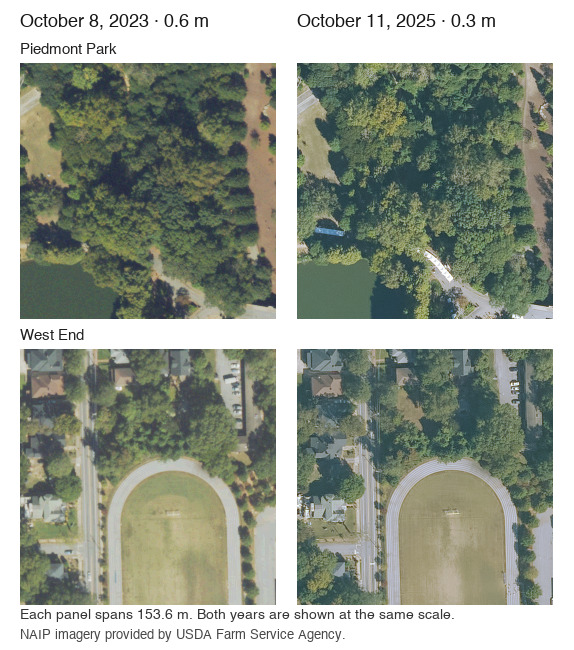

# T01 — Atlanta imagery interval check

Launched 2026-11-22 by Codex on `codex/t01-imagery` from `eeb5e0f`. Starting evidence is the [saved NAIP catalog screen](../2026-10-14-planning/findings.md#e1--imagery-catalog-probe) and its unsigned tile URLs. Write reservation covers the imagery research record, imagery manifests, local sample cache and T01 checklist status. No other workstream is claimed.

Check public distributor metadata for 2025 Georgia NAIP and read actual four-band windows from two dates at up to three Atlanta development locations. Prefer 2023–2025, with 2019–2023 as fallback. Preserve source identities, rights, dates, grid, nodata, window hashes and observed suitability in a compact ledger. Inspect visible shadows, leaf state and alignment limits before recommending an interval. No training, protected evaluation, citywide acquisition, spending or external messages.

Limit discovery to twelve source/catalog lookups plus bounded tile/index/range requests for selected samples, up to 1 GiB of imagery transfers and 2 GiB of temporary storage. Stop at sufficient local evidence or document the failed routes and exact recovery action. Temporary pixels may disappear. T04 owns durable storage. Next action at launch is to locate the official 2025 distribution and test the first corresponding window.

## Result

Use October 2023 to October 2025 for local development. Both services returned four distinct, nonconstant uint8 bands covering the same 153.6 m square at each site in NAD83 / UTM zone 16N (EPSG:26916). The 2023 samples are 256 × 256 at 0.6 m. The 2025 samples are 512 × 512 at 0.3 m. Each request specified source bands 0–3 in order. NAIP documents these as red, green, blue and near-infrared. The exports have undefined band labels, so band identities rely on the provider. [NAIP collection metadata](../2026-10-14-planning/source-probes.json). None of the four exports declared nodata or masked any pixels, and none contained a pixel with zeros in all four bands. Shadows and water still require interpretation.

| Development location (center, WGS84) | 2023 USGS tile and acquisition date | 2025 USDA tile and acquisition date |
|---|---|---|
| Piedmont Park, 33.787° N, 84.372° W | 3308414 SW · October 8 | 3308414 SW · October 11 |
| West End, 33.735° N, 84.423° W | 3308421 NE · October 8 | 3308421 NE · October 11 |



At Piedmont Park, leafy crowns, a lakeshore and paths are visible in both years. Crown shadows obscure parts of the paths. In West End, the running track and adjacent street provide clearer fixed features. The 2025 images are sharper and have different colors. A shift in brightness or crown edge between dates could therefore be an imaging difference. Roads and paths line up by eye at this scale. Registration error remains unmeasured. The preview averages the 2025 RGB pixels to the display scale. Hashes use the original four-band exports.

Dates come from the tile acquisition fields, corroborated by the tile names. The timing of individual flight strips within each tile remains unverified. Use local flight dates and measure residual offsets on held-out stable ground features before interpreting small events. T02 can use the tile IDs once it has the city boundary to inventory 2023/2025 coverage. T04 can use one of these real windows as its recovery fixture. Two selected locations establish sample access only. Citywide coverage, change accuracy and suitability for parcel attribution remain open. The recent pair was accessible, so the 2019 fallback was unnecessary.

An independent reviewer decoded the four original TIFFs, reproduced all file and band-major hashes, pixel ranges and mask counts, and checked the footprints and previews. The reviewer supported the local-development recommendation and identified registration, image sharpness, shadows and tile-date precision as limits.

Fresh downloads reproduced the original TIFF bytes for both Piedmont Park years and West End 2025. The initial West End 2023 read succeeded, but repeat export requests timed out or returned HTTP 504. Its original TIFF remains locally hash-verified. For an immediately reproducible two-date fixture, use Piedmont Park.

## Access and source selection

The saved planning catalog supplied the 2023 quarter-quad identifiers. A USGS index query at the park returned two overlapping 2023 tiles. We selected the quarter quad matching the 2025 tile by name. The second location uses a different quarter quad. Both locations were chosen for development before viewing their pixels. Record these footprints as inspected when defining protected geography.

The [USGS imagery index](https://index.nationalmap.gov/arcgis/rest/services/USGSNAIPImageryIndex/MapServer/0) describes the NAIP orthophotos as public domain. The [2023 USGS image service](https://imagery.nationalmap.gov/arcgis/rest/services/USGSNAIPImagery/ImageServer) and the [2025 USDA image service](https://apps.geo.fpac.usda.gov/geo-imagery/rest/services/naip/conus_naip/ImageServer) expose individual dated tiles. We used each tile's own image endpoint to avoid a changing default mosaic. The 2025 tile metadata explicitly permits reuse and requests credit. NAIP imagery provided by USDA Farm Service Agency.

USDA also lists [Fulton](https://nrcs.app.box.com/v/naip/file/2094469710915) and [DeKalb](https://nrcs.app.box.com/v/naip/file/2094524982359) county mosaic ZIPs of 6,393,392,971 and 1,909,801,988 bytes respectively, plus the [Georgia seamlines](https://nrcs.app.box.com/v/naip/file/2093473093347). We verified the directory entries only. The county downloads exceed the sample budget. Anonymous listing of the attempted USGS S3 bucket returned HTTP 403. An optional USGS item key-properties request returned HTTP 502. Neither failure prevented a pixel read.

## Reproduction

The four original service exports (2,628,338 bytes total) are preserved locally in `data/imagery/t01/` and excluded from Git. Each copy passed its whole-file hash check. The JPEG preview and JSON ledger travel with the research record. T04 still owns durable storage.

The [window manifest](../../../manifests/imagery/t01-windows.json) records the original tile names, acquisition fields, service metadata, unsigned TIFF requests, native and output grids, observed nodata, band ranges and hashes. From the repository root, use curl and Python with Rasterio 1.4.4 and NumPy 2.3.5. Use a fresh directory for a full retrieval test. After an interrupted run, reuse the directory to skip byte-identical files already retrieved.

```sh
python docs/research/imagery/recover_windows.py /tmp/t01-recovered-windows
```

The script checks source identity, grid and SHA-256 of the four decoded uint8 bands in band-major row order. A change in TIFF packaging is reported separately. If an object ID changes, look up its recorded tile name and verify the pixels and grid before revising the manifest. Source services can retire an acquisition. Local temporary files and these retrieval checks carry no long-term retention guarantee.
